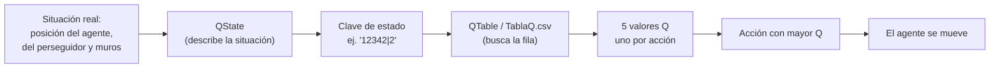
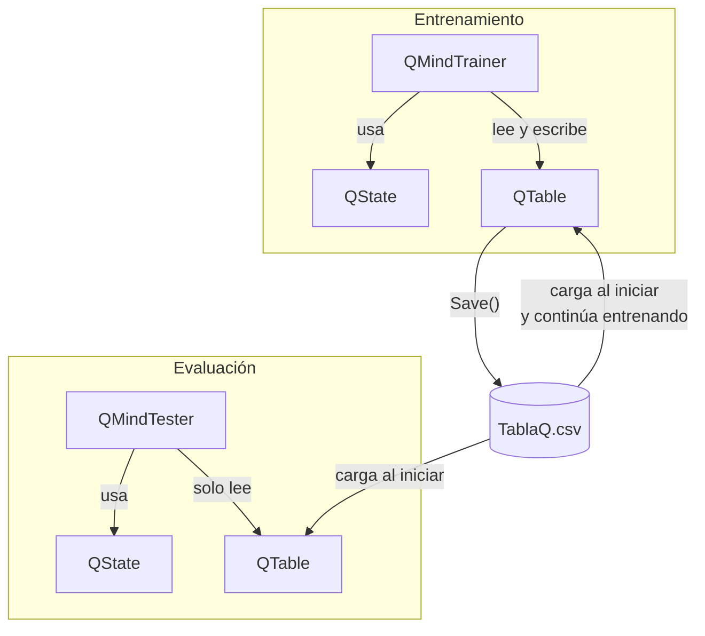
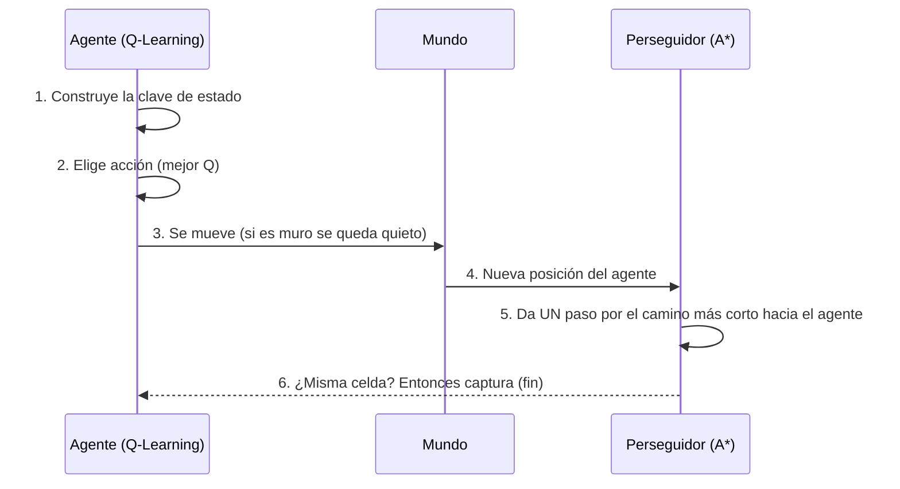
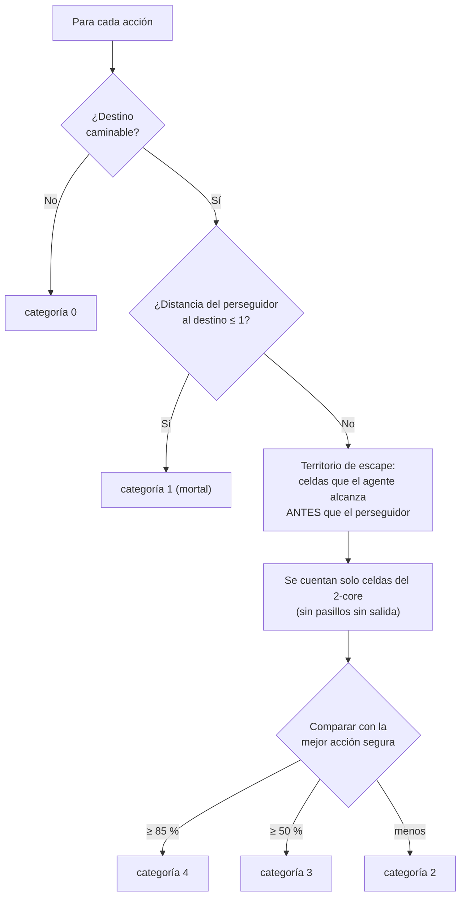
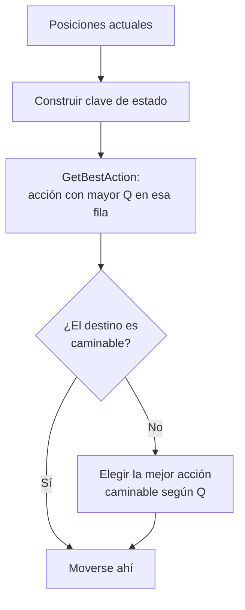
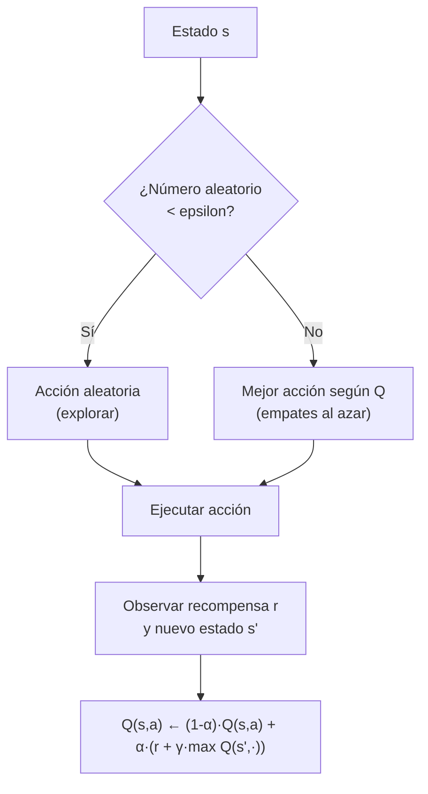

# Cómo decide el agente: guía del código de `GrupoA`

Este documento explica, a partir del código entregado, **qué decide el agente en cada turno**, por qué esa decisión es buena y para qué sirve cada archivo y cada función de la carpeta `GrupoA`.

---

## 1. Resumen en una página

- El agente es un NPC que huye de un perseguidor en una cuadrícula 20 × 20 con muros.
- En cada turno **elige una de 5 acciones**: `Up`, `Down`, `Left`, `Right`, `Stay`.
- No planifica ni simula el futuro durante la partida. Hace **una consulta a una tabla**: convierte la situación en una clave de texto (el *estado*) y toma la acción con mayor valor Q en esa fila.
- Los valores de esa tabla se aprendieron con **Q-Learning**: cada valor Q(s,a) estima cuánto "vale" tomar la acción *a* en el estado *s* (más alto = más pasos de supervivencia esperados; ≈ −100 = captura casi segura).
- La inteligencia está repartida en dos sitios: en **cómo se describe la situación** (`QState`) y en **los valores aprendidos** (`TablaQ.csv`).



---

## 2. Qué hace cada archivo de `GrupoA`

| Archivo | Finalidad |
|---|---|
| `QState.cs` | Traduce la situación del juego (agente, perseguidor, muros) en una **clave de estado** compacta y válida para cualquier mapa. |
| `QTable.cs` | Guarda y consulta la **tabla de calidad** Q(s,a): lee, escribe y busca el máximo y la mejor acción. |
| `QMindTrainer.cs` | **Entrena**: ejecuta episodios, elige acciones con exploración, calcula recompensas y actualiza la tabla con la fórmula de Q-Learning. |
| `QMindTester.cs` | **Juega** con la tabla ya entrenada, sin explorar ni aprender. Es lo que se usa para evaluar. |
| `TablaQ.csv` | La **tabla entrenada** (una fila por estado, una columna por acción). Es el "cerebro" del agente. |



`QTableStorage` (en `QMind`, proporcionado por los profesores) es quien lee y escribe el CSV; `QTable` se apoya en él.

---

## 3. Qué ocurre en un turno

Orden de las acciones, igual en entrenamiento y en evaluación:



Consecuencia importante: el agente solo es capturado si, **después de moverse**, el perseguidor puede llegar a su celda en un paso. Por eso el estado marca como *mortal* cualquier destino a distancia de camino ≤ 1 del perseguidor. Y por eso, con la misma velocidad, el agente queda siempre a una casilla del perseguidor: es lo más ajustado que sigue siendo seguro.

---

## 4. Qué decide el agente: el estado

`QState` calcula, para **cada una de las 5 acciones**, una categoría:

| Categoría | Significado |
|---|---|
| `0` | Bloqueada: la celda destino es un muro o está fuera del tablero |
| `1` | Mortal: tras moverme, el perseguidor llega a mi celda (distancia de camino ≤ 1) |
| `2` | Segura, pero lleva a una zona de escape pequeña |
| `3` | Segura, zona de escape intermedia |
| `4` | Segura, la mejor zona de escape (≥ 85 % de la mejor opción) |

A eso se añade un dígito con la distancia de camino al perseguidor (`1, 2, 3, 4+`, o `5` si no hay camino).

**Clave = `c(Up) c(Down) c(Left) c(Right) c(Stay) | distancia`**, por ejemplo `12342|2`.

### Cómo se calcula la calidad de un destino seguro



Dos ideas explican la calidad de esta descripción:

1. **Territorio de escape.** Una celda es "mía" si la alcanzo en menos pasos que el perseguidor. Cuantas más celdas mías tenga un destino, más espacio de maniobra tendré allí.
2. **2-core.** Se eliminan, repetidamente, las celdas con un solo vecino caminable (pasillos sin salida). Lo que queda son celdas por las que se puede dar vueltas. Contar solo esas evita que el agente confunda un pasillo largo con una zona segura, que fue el error principal que corregí al diseñarlo.

Como todo es **relativo** (calidad respecto a la mejor opción) y no usa coordenadas, el mismo estado vale en cualquier mapa.

---

## 5. Qué decide el agente: la acción

### En evaluación (`QMindTester`)



No hay azar ni aprendizaje: dada la misma situación, siempre la misma decisión.

### En entrenamiento (`QMindTrainer`)



Epsilon empieza en el valor del Inspector y baja linealmente hasta 0,05 durante el 70 % de los episodios. Por eso al principio el agente parece torpe: está explorando.

### Qué significan los valores Q

| Valor típico | Interpretación |
|---|---|
| ≈ +19 / +20 | Acción segura que permite seguir sobreviviendo (≈ 1/(1−γ) = 20 con γ = 0,95) |
| valores intermedios | Seguras, pero llevan a zonas con menos espacio de escape |
| ≈ −100 | Captura casi segura |

---

## 6. Ejemplo real de decisión

Fila de `TablaQ.csv` (columnas: Up, Down, Left, Right, Stay):

```
12342|2  →  [-48.8,  9.1,  1.8,  18.7,  9.5]
```

Lectura de la clave `12342|2`:

| Acción | Categoría | Significado | Q |
|---|---|---|---|
| Up | 1 | Mortal | −48.8 |
| Down | 2 | Segura, zona pequeña | 9.1 |
| Left | 3 | Segura, zona media | 1.8 |
| Right | 4 | Segura, mejor zona | **18.7** |
| Stay | 2 | Segura, zona pequeña | 9.5 |

El agente elige **Right**: no solo es segura, es la que más espacio de escape ofrece. Up se descarta por mortal. Obsérvese que Left (más amplia que Down) vale menos que Down: los valores Q recogen lo que ocurre *después* en la práctica, no solo la categoría de la jugada.

Otro caso extremo:

```
40011|1  →  [19.8, -100, -100, -100, -100]
```

Solo Up (categoría 4) es una salida segura. Right y Stay son mortales y Down/Left son muros, que equivalen a quedarse quieto con el perseguidor pegado. La decisión es obvia: Up.

---

## 7. Referencia función por función

### 7.1 `QState.cs`

| Elemento | Propósito |
|---|---|
| `SetWorld(WorldInfo)` | Prepara la información estática del mapa: qué celdas son caminables y cuáles pertenecen al 2-core. Se calcula una sola vez por mundo y se reutiliza. |
| `ComputeTwoCore()` | Quita iterativamente celdas con ≤ 1 vecino caminable (pasillos sin salida) y devuelve las que quedan. |
| `CountWalkNeighbours(i)` | Cuenta los vecinos caminables de una celda (apoyo de `ComputeTwoCore`). |
| `InBounds(x, y)` | Indica si una coordenada está dentro del tablero. |
| `IsWalkable(x, y)` | Indica si la celda está dentro del tablero y no es muro. |
| `Bfs(start, dist)` | Búsqueda en anchura: rellena `dist` con los pasos mínimos desde `start` a cada celda caminable (`9999` si es inalcanzable). Sirve para medir distancias de camino. |
| `QState(agent, other)` | Constructor corto: usa el mundo registrado con `SetWorld`. |
| `QState(agent, other, world)` | Constructor principal: calcula las 5 categorías y el dígito de distancia (ver sección 4). |
| `ActionCategories` | Las 5 categorías calculadas (una por acción). |
| `ChaserDistanceBucket` | Distancia al perseguidor saturada a 4; 5 si es inalcanzable. |
| `ToKey()` | Convierte el estado en la clave de texto usada en la tabla, p. ej. `12342|2`. |

### 7.2 `QTable.cs`

| Función | Propósito |
|---|---|
| `QTable(storage)` | Guarda el almacenamiento (diccionario + CSV) y los nombres de las acciones. |
| `EnsureState(key)` | Si el estado no existe, crea su fila con 5 ceros. Garantiza que nunca falle una consulta. |
| `GetQ(key, action)` | Devuelve Q(s,a). |
| `SetQ(key, action, value)` | Escribe Q(s,a). |
| `GetMaxQ(key)` | Devuelve el mayor Q de la fila. Se usa en el término `γ·max Q(s',·)` de la actualización. |
| `GetBestAction(key)` | Devuelve la acción con mayor Q (en empate, la primera del enum: Up, Down, Left, Right, Stay). |
| `SaveToCsv()` | Guarda la tabla en `TablaQ.csv`. |

### 7.3 `QMindTrainer.cs`

**Constantes**: `RewardSurvive = +1`, `RewardCaptured = −100`, `RewardBump = −5`, `EpsilonMin = 0.05`, `EpsilonDecayFraction = 0.7`, `DefaultMaxSteps = 500`.

| Función | Propósito |
|---|---|
| `Initialize(params, world, navigation)` | Guarda parámetros y mundo, registra el mundo en `QState`, carga `TablaQ.csv` si existe (para continuar entrenando) y arranca el primer episodio. |
| `StartNewEpisode()` | Reinicia contadores y coloca agente y perseguidor en celdas aleatorias, caminables y distintas. |
| `EndEpisode()` | Guarda la tabla si procede (cada `episodesBetweenSaves` episodios y en el último), avisa al componente de Unity y empieza otro episodio o termina. |
| `DoStep(train)` | **Un turno completo**: estado → acción → mover agente y perseguidor → estado siguiente → recompensa → actualizar Q (si `train`) → comprobar fin de episodio. |
| `BuildStateKey(...)` | Crea un `QState` y devuelve su clave. |
| `ChooseAction(key, train)` | Con `train` falso elige la mejor acción; con `train` verdadero usa ε-greedy (azar con probabilidad ε, si no la mejor con empates al azar). |
| `UpdateQ(...)` | Aplica la fórmula de Q-Learning. En estado terminal el objetivo es solo la recompensa (no hay futuro). |
| `ComputeReward(agent, other, bumped)` | −100 si hay captura, −5 si se chocó con un muro, +1 en otro caso. |
| `IsTerminalState(agent, other)` | Verdadero si ambos están en la misma celda. |
| `ApplyAction(cell, action)` | Calcula la celda destino de una acción; devuelve `null` si sale del tablero. |
| `MoveOpponent(opponent, target)` | Pide al algoritmo A* el primer paso del perseguidor hacia el agente. |
| `SameCell(a, b)` | Compara dos celdas por coordenadas. |
| `EffectiveMaxSteps()` | Tope de pasos por episodio: el del Inspector, o 500 si vale −1. |
| `CurrentEpsilon()` | ε del episodio actual: baja linealmente desde el valor del Inspector hasta 0,05. |

### 7.4 `QMindTester.cs`

| Función | Propósito |
|---|---|
| `Initialize(worldInfo)` | Registra el mundo en `QState` y carga `TablaQ.csv`. |
| `GetNextStep(current, other)` | Devuelve la celda a la que se mueve el agente: la de la mejor acción de la tabla, o, si es un muro, la mejor acción caminable (red de seguridad). |
| `BuildStateKey(...)` | Igual que en el trainer. **Debe mantenerse idéntico** a `QMindTrainer.BuildStateKey`, o las claves no coincidirán con las de la tabla. |
| `ApplyAction(cell, action)` | Celda destino de una acción, `null` si queda fuera del tablero. |

### 7.5 `TablaQ.csv`

Texto separado por `;`. Primera línea: `State;Up;Down;Left;Right;Stay`. Cada línea siguiente es un estado y sus 5 valores Q. Se cargan al iniciar y, en entrenamiento, se reescriben al guardar.

---

## 8. Límites del agente

- **No ve el futuro lejano.** Solo conoce el espacio de escape inmediato (territorio) y la distancia al perseguidor. No hay memoria entre turnos: decide solo con la situación actual.
- **Depende de la descripción del estado.** Si dos situaciones distintas producen la misma clave, el agente las trata igual.
- **Estados no vistos** en el entrenamiento tienen todos los Q a 0; en ese caso el tester coge `Up` si es caminable, o la mejor acción caminable. En mi simulación de validación no aparecieron, pero con mapas muy distintos podrían aparecer.
- **Cualquier agente perfecto** sería alcanzado en algunos mapas: si la zona donde está no tiene ciclos, el perseguidor acaba arrinconándolo.
