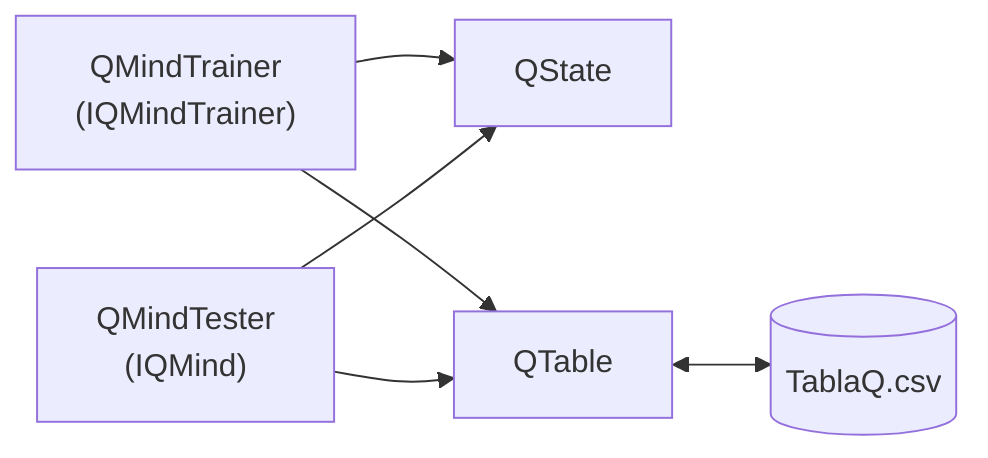

# Práctica de Aprendizaje Automático (Q-Learning)

Desarrollo de Juegos con Inteligencia Artificial

**Grupo:** GrupoA

**Integrantes:**

* Diego Gil Luengo
* Estanislao de Koska Castrillón Román

# Práctica de Aprendizaje Automático (Q-Learning)

**Resumen.** Se entrena con Q-Learning un agente que huye de un perseguidor `A*` en una cuadrícula 20x20 con muros
arbitrarios. La clave del resultado es un estado compacto e independiente del mapa. La tabla final tiene 1137 estados y,
en simulación sobre mapas no vistos, el agente aguanta de media unos 7600 de 8000 pasos.

---

## 1. Clases implementadas

Carpeta `GrupoA`, namespace `GrupoA`.

| Clase          | Función                                                                                                                                                       |
|----------------|---------------------------------------------------------------------------------------------------------------------------------------------------------------|
| `QState`       | Convierte (agente, perseguidor, muros) en la clave de estado. Precalcula una vez por mapa las celdas caminables y el 2-core, y usa BFS para medir distancias. |
| `QTable`       | Tabla Q sobre `Dictionary<string,float[]>`: clave = estado, array de 5 valores (uno por acción). Implementa `GetQ`, `SetQ`, `GetMaxQ`, `GetBestAction`.       |
| `QMindTrainer` | Bucle de entrenamiento Q-Learning: política epsilon-greedy, recompensa, estado terminal, tope de pasos y guardado del CSV.                                    |
| `QMindTester`  | Política greedy sobre `TablaQ.csv`. Si la mejor acción da a un muro, usa la mejor acción caminable.                                                           |

---

## 2. Diseño formal del estado

Sea $G$ el grafo de celdas caminables con vecindad de 4 y $d (u,v)$ la distancia de camino mínimo entre las celdas $u$
y $v$ ($d (u,v)=\infty$ si no hay camino). Sean $p_a$ la celda del agente y $p_c$ la del perseguidor. El conjunto de
acciones es

$$\mathcal{A} = \{\text{Up}, \text{Down}, \text{Left}, \text{Right}, \text{Stay}\}$$

y, para cada acción $a \in \mathcal{A}$, $n (a)$ es la celda destino de aplicar $a$ desde $p_a$.

**Territorio de escape.** Se define

$$T (a) = \left| \{\, x \in K \;:\; d (n (a), x) < d (p_c, x) \,\} \right|$$

donde $K$ es el **2-core** de $G$ (se eliminan iterativamente las celdas con un vecino o ninguno, es decir, los pasillos
sin salida). Si ninguna acción tiene $T > 0$, se toma $K = V$ (todas las celdas). $T (a)$ cuenta las celdas por las que
el agente puede seguir huyendo y que alcanza antes que el perseguidor.

**Categoría de cada acción.** Sea $T_{max}$ el máximo de $T$ entre las acciones seguras.

| $c(a)$ | Condición                                                                         |
|--------|-----------------------------------------------------------------------------------|
| $0$    | $a \neq \text{Stay}$ y $n(a)$ es un muro o está fuera del tablero                 |
| $1$    | acción mortal: $d(p_c, n(a)) \le 1$ (el perseguidor llega a mi celda en su turno) |
| $4$    | acción segura con $T(a) \ge 0.85\,T_{max}$                                        |
| $3$    | acción segura con $0.5\,T_{max} \le T(a) < 0.85\,T_{max}$                         |
| $2$    | acción segura con $T(a) < 0.5\,T_{max}$                                           |

**Estado.**

$$s = \big (c (\text{Up}),\, c (\text{Down}),\, c (\text{Left}),\, c (\text{Right}),\, c (\text{Stay}),\, b\big)$$

con $b = \min\big (d (p_c, p_a),\, 4\big)$, y $b = 5$ si el agente es inalcanzable para el perseguidor. Se codifica como
una cadena, por ejemplo `12342|2`.

El número de estados posibles cumple $\lvert S \rvert \le 5^5 \cdot 5 = 15625$. En el entrenamiento aparecieron 1137. El
estado no usa coordenadas absolutas ni el número o la forma de los muros, y las calidades son relativas a la mejor
opción. Por eso la misma tabla sirve para cualquier escenario.

---

## 3. Diseño formal de la recompensa

$$
R (s,a,s') =
\begin{cases}
-100 & \text{si } p'_a = p'_c \quad \text{ (captura, estado terminal)}\\[2pt]
-5 & \text{si } a \text{ lleva a un muro o fuera del tablero (el agente se queda quieto)}\\[2pt]
+1 & \text{en otro caso}
\end{cases}
$$

La puntuación es el número de pasos sin ser capturado, así que cada paso vivo se premia con $+1$.
Con $\gamma = 0.95$, un estado seguro vale aproximadamente $\frac{1}{1-\gamma} = 20$, y la captura $-100$ domina ese
horizonte. La penalización de $-5$ enseña a no chocar con los muros ni salirse del tablero.

---

## 4. Procedimiento de entrenamiento

**Algoritmo.** Q-Learning, con $Q (s,a) = 0$ inicialmente:

$$Q (s,a) \leftarrow (1-\alpha)\,Q (s,a) + \alpha\,\Big (r + \gamma \max_{a'} Q (s',a')\Big)$$

y, si $s'$ es un estado terminal, el objetivo es solo $r$:

$$Q (s,a) \leftarrow (1-\alpha)\,Q (s,a) + \alpha\, r$$

| Parámetro                      | Valor                                                                        |
|--------------------------------|------------------------------------------------------------------------------|
| Aprendizaje $\alpha$           | $0.2$                                                                        |
| Descuento $\gamma$             | $0.95$                                                                       |
| Exploración $\varepsilon$      | de $0.9$ a $0.05$, con decrecimiento lineal durante el 70% del entrenamiento |
| Desempates en la acción greedy | al azar en entrenamiento                                                     |

---

## 5. Evaluación del agente

---

## 6. Análisis de dos filas de la tabla de calidad

Las columnas de cada fila son, en orden: Up, Down, Left, Right, Stay.

**Fila `40011|1`:** $Q = [\,19.8,\ -100,\ -100,\ -100,\ -100\,]$

Up es la única salida segura y además de calidad máxima ($c = 4$). Right y Stay ($c = 1$) son mortales: el perseguidor
está pegado al agente. Down y Left ($c = 0$) son muros, y chocar equivale a quedarse quieto con el perseguidor
adyacente. El agente aprendió que todo lo demás acaba en captura ($Q \approx -100$), y que Up conserva el valor de
seguir vivo ($Q \approx 20 = \frac{1}{1-\gamma}$).

**Fila `12342|2`:** $Q = [\,-48.8,\ 9.1,\ 1.8,\ 18.7,\ 9.5\,]$

Up ($c = 1$) es mortal y obtiene el peor valor. Las otras tres acciones son seguras, pero con distinto espacio de
escape: Right ($c = 4$) tiene la mayor zona y el mayor valor Q, y es la acción elegida. Down y Stay ($c = 2$) valen
aproximadamente la mitad. Left ($c = 3$) queda por debajo de ambas a pesar de su categoría, porque en la práctica
conduce a situaciones peores.

Esto muestra que la tabla no solo separa lo seguro de lo mortal, sino que ordena las
salidas seguras por el espacio de escape que dejan.